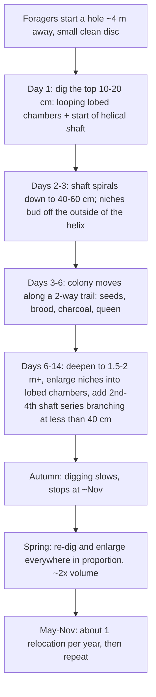
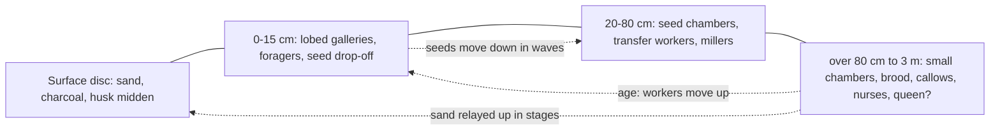

# Pogonomyrmex badius: How the Nest Is Dug (Excavation, Shape, Growth, Chamber Use)

*Date: 2026-10-10. Written for Brandon's ant-farm simulation. Builds on part2_E-H.md (Q35–46), Roles-Behavior.md and the full texts in /workspace/antsim/src/.*

**Tags used below:** **P. badius** = measured in this species. **BORROWED (species)** = taken from another species. **Couldn't find it** = no data located. **via abstract** = only the abstract was read. **DESIGN** = a simulation choice, not data.

---

## Summary

- **A nest is dug fast, not grown slowly.** Most colonies move about once a year, around 4 m. A colony digs a complete, species-typical nest in **3–6 days**, and most of the volume is dug within **about 2 weeks**. "No colony occupies an enlargement of its founding nest." The top-heavy shape is the "intentional" outcome of a short digging period, not the result of years of growth (Tschinkel 2004; 2014). **P. badius.**
- **The plan is the same at every size.** One to four helical shafts (shaft about 1 cm wide; helix 4–6 cm across) carry flat, roughly 1 cm-high chambers. Chambers start as circular niches on the outside of the spiral and become lobed as they are enlarged. The top 10–15 cm is a looping, lobed network. Chamber area per depth decile falls **25–40% per 10% of depth**, and about **50% of all area lies in the top quarter** of the depth. Spacing grows from **2–4 cm** near the surface to **20–30 cm** deep down. **P. badius.**
- **Order of digging in a new nest:** surface entrance, then the top layer (10–20 cm), then deepening and enlargement of all levels at the same time. In a planted colony of 10,000 workers, the nest reached 30–40 cm by day 2, touched 50–60 cm on day 3 and passed 150 cm by day 14. The volume was about 4 L by November and about 8 L after the spring re-dig (Tschinkel, Rink & Kwapich 2015). **P. badius.**
- **Size scales with workers:** depth ∝ workers^0.37, area ∝ workers^0.87. Depth runs from 30–50 cm (incipient) to 2.5–3 m (mature). Chamber count runs from 1 to about 150. **P. badius.**
- **Chamber use is set by who lives at each depth, not by a plan.** Foragers stay in the top 12–20 cm. Seeds are stored 20–100 cm deep (most at 30–80 cm). Brood and callows are in the bottom third (>80 cm). Over 98% of brood is deep; less than 2% is temporarily in the warm top chambers. Workers move upward as they age. The proposed cue for both chamber layout and sorting by depth is the **soil CO₂ gradient**, which is about 5× higher at the bottom (a hypothesis). **P. badius.**
- **How the digging works:** workers bite sand pellets of about 50–400 grains (mean 162). Sand goes up in a **relay**: workers drop and re-form pellets on the way up, and about 2.5% stays underground as backfill or wall lining. Excavation is done mostly by older, darker workers on their way to becoming foragers. **P. badius.** The positive feedback (recruitment, pheromone in the soil) and the stopping rule (density) come from lab work on other species: **BORROWED (Messor sancta, Lasius niger).**

---

## 1. Order of construction

### 1a. Founding queen
- **Founding chamber depth and shape: Couldn't find it** for P. badius. P. badius is reported to be claustral (secondary source; see part1_A-D.md).
- **Incipient nests:** 29–37 cm deep (Results section) or "usually 40 to 50 cm" (abstract). These are small versions of the same plan, with about 1 shaft and a few chambers. Top-decile area is about 38 cm² in the smallest size class. About 40 g of sand is removed in total (Tschinkel 2004). **P. badius.**
- How a founding cell becomes an incipient nest has not been observed directly (**Couldn't find it**). Because colonies move about once a year, any nest you excavate is a relocation nest.

### 1b. Relocation nest: the sequence (main data)
| Time | What happens | Source |
|---|---|---|
| Day 0 | A subgroup of foragers starts a new hole about 4 m away (mean 4.1 m). A small, clean sand disc appears, linked to the old nest by a 2-way trail. | Tschinkel 2014; 2015 — **P. badius** |
| Daylight on each move day | Workers bring sand pellets up and drop them on the growing disc. Digging and trailing stop before sunset, and both nests' entrances are closed overnight. Trails run when the trail temperature is between about 25 and 45 °C. | Tschinkel 2014 — **P. badius** |
| Day 1 | In the planted colony, all excavation was in the **10–20 cm layer**: the top is dug first. | Tschinkel et al. 2015 — **P. badius** |
| Day 2 | The nest reached the bottom of 30–40 cm. | ibid. |
| Day 3 | The nest touched 50–60 cm. The top layer now supplied ≤50% of the sand; deepening and enlargement ran in parallel. | ibid. |
| Days 4–6 (up to 8) | The move is done: about 22% of moving workers carry something (80% of loads are seeds, 13% brood, 7% charcoal). The queen and brood arrive along the trail. | Tschinkel 2014 — **P. badius** |
| Day 7 | Layers 10–50 cm were dug about equally, and less was dug at 50–90 cm. | Tschinkel et al. 2015 |
| Day 14 | Depth was more than 150 cm. "Most of the excavation" was complete. New nests mapped less than 2 weeks after a move were about 5% shallower than the old nests and still being finished. | Tschinkel et al. 2015; Tschinkel 2014 |
| Autumn into winter | Digging slows. In the planted colony it stopped about 1 Nov at about 4 L. The colony was nearly inactive and had no brood. | Tschinkel et al. 2015 |
| March (spring) | Digging resumes **everywhere in proportion to existing volume**, roughly doubling the nest to about 8 L. | ibid. |

- **Depth over time (planted colony of 10,000 workers):** about 40 cm by day 2, about 50 cm by day 3, more than 150 cm by day 14, and finally about 2 m. **P. badius.** (The planted colony's architecture was "less crisply organized" than a natural nest, but its area-vs-depth curve was normal.)
- **Which part first:** shaft and top chambers first, then deepening and new chambers together. Deepening, chamber addition and enlargement happen "more or less simultaneously", so the proportions are always species-typical (Tschinkel 2004; 2015). A new shaft series branches off at less than 40 cm depth (Q39).

---

## 2. Shapes (all P. badius, Tschinkel 2004 unless noted)

- **Shafts:** **helical**, more often left-handed. Helix diameter 4–6 cm. Shaft bore a little under 1 cm; upper shafts are flattened "racetrack" ribbons up to about 2 cm wide. Descent angle is 20–30° from horizontal near the surface and 45–60° (up to about 70°) below about 50 cm. One turn spans 8–10 cm of shaft near the top and about 20 cm deeper. A nest has 1–4 shaft series (rarely 5).
- **Chambers:** about 1 cm high, with a flat floor and a slightly domed ceiling.
  - Top 10–15 cm: modified, widened shafts forming a looping, interconnected, multi-lobed gallery. Mean area is 26 cm² in small colonies and about 330 cm² in large ones.
  - Below 15–20 cm: chambers start as a circular niche on the outer wall of the helix and become lobed as they grow. In the upper third, the perimeter is 2–7× that of a circle of the same area.
  - Chambers near the surface are about 5–6× larger than those near the bottom.
- **Area vs depth:** each 10% depth step holds 25–40% less area (log-log slope about −0.59). About 50% of total area lies in the top 25% of the depth. The curve keeps the same shape at every colony size ("size-free shape").
- **Spacing:** 2–4 cm near the top, rising to 20–30 cm at depth. Spacing is widest at 70–80% of maximum depth and slightly tighter at the very bottom.
- **Connections:** each chamber hangs on its shaft. Separate shaft series are linked through the shallow gallery network.

### Depth profile (example: a mature nest about 2 m deep, ~5,000 workers)
| Depth band | Chamber shape and size | Vertical spacing | Contents and use |
|---|---|---|---|
| 0–15 cm | Looping, interconnected, multilobed galleries, up to about 330 cm² each (large colony). Frequently backfilled and re-dug. | 2–4 cm | Foragers (96% are in the top 20 cm; none deeper than 12 cm in sorted nests). Seed drop-off point. Sand pellet staging. Occasionally brood (<2%) in warm periods. |
| 15–40 cm | Large lobed niches on the helix. Shaft branch points (<40 cm). | about 4–10 cm (interpolated) | Transfer workers and sand relays. Upper seed chambers (from about 20–30 cm). |
| 40–100 cm | Medium chambers with fewer lobes. | about 10–25 cm (interpolated) | **Main seed stores (30–80 cm; 40–100 cm in the 1999/2004 data).** Millers. |
| 100 cm to bottom (about 2–3 m) | Small, simple, near-circular chambers, about 1/5–1/6 the area of the top chambers. | 20–30 cm (widest at 70–80% of maximum depth) | Brood, callows, nurses and the young-worker bulk. The queen is presumably here (**queen depth: Couldn't find it**). CO₂ is about 5× the surface level. |

---

## 3. Progression over the colony's life
- **Scaling (P. badius):** log MaxDepth = 0.95 + 0.37 log(dark workers). log Area = 0.55 + 0.87 log(dark workers). Total sand removed runs from about 40 g (incipient) to about 40 kg (largest). The nest grows mainly through chamber enlargement, plus deepening and new shaft series. Colony size and number of shaft series: 1 series ≈ 1,700 workers, 2 ≈ 3,200, 3 ≈ 4,600, 4 ≈ 5,000.
- **Area per ant falls** as colonies grow (exponent below 1).
- **Seasonal pattern:** digging runs during warm months. Relocations happen May–November and peak in July (>1% of colonies per day). Winter (Nov–Mar) brings no foraging and little digging. The spring re-dig roughly doubled the volume in the planted colony. Tschinkel & Hanley 2017 suggest nests probably "contract seasonally" with demography (speculative wording). **Measured seasonal contraction or refill volumes: Couldn't find it.**
- **Refilling / remodeling:** in the planted colony, about 2.5% of the sand (321 g of 13 kg) was deposited underground, about 75% of it in the top 30 cm. Of that deposit, 42% was backfills, 40% chamber floors and 1% filled shafts. About 20% of the top chamber's 1,009 cm² was backfilled. A partly filled chamber 30–50 cm deep was re-dug within 1–3 days (Tschinkel et al. 2015). **P. badius.**
- **Relocation frequency:** about 1 per year (individual colonies range from 1 per 2 years to 4 per year), a mean of 4 m, taking 4–6 days. Old and new nests "differed little in size, depth, chamber shape and chamber distribution" (Tschinkel 2014). **P. badius.**

## 4. How chambers get their purposes
- **Not planned. Depth sorts the workers, and the workers' jobs define the chambers.** Workers sit by age: the young are deep and move upward as they age, up to 3–4 m in harvester ants generally. The material each group handles ends up where that group lives (Tschinkel 2004; Kwapich & Tschinkel 2013). **P. badius.**
- **Seeds:** foragers drop seeds in the topmost chambers. A different group carries them down in stages, as a "wave", into seed chambers at 20–80 cm within hours to about 1 day. Seed piles may act as a stigmergic "drop here" cue (a hypothesis in Tschinkel et al. 2015).
- **Brood:** in the bottom third (>80 cm) year-round, with less than 2% in warmer near-surface chambers "temporarily" (Tschinkel & Hanley 2017). **Daily up-and-down brood shuttling measured in P. badius: Couldn't find it.** Tschinkel 2004 only speculates that shallow chambers may matter for brood in cool months.
- **Template:** the CO₂ gradient mirrors the area-by-depth curve and is the proposed cue for both architecture and sorting (a hypothesis, P. badius). Temperature and moisture "probably vary too much" to act as the template (Tschinkel 2004).
- **Do chamber uses change?** Every relocation resets them. Within a nest, use is inferred to follow seasonal demography (callows appear Jun–Oct; brood is absent in winter). **Chamber-level time series: Couldn't find it.**
- **Refuse:** dead ants are carried up to about 6 m away. A seed-husk midden sits on or near the disc (Gordon 1984). No internal refuse chamber was reported for P. badius (**Couldn't find it**).

## 5. Mechanics
- **Pellets (P. badius):** 50–400 grains, mean 162. Grain volume is about 0.015 mm³, and dry packed sand density is 1.5 g/cm³. A rough derived pellet mass is about 162 × 0.015 mm³ × 2.65 mg/mm³ ≈ **6 mg** (my arithmetic, not a measured value). Pellets are fragile and get dropped and re-formed on the way up, mixing sand from different depths (mean 4.4 sand colors per pellet). Pogonomyrmex also uses its **psammophore** (a basket of setae under the head) to carry more than 2× as much dry sand as with the mandibles alone (Porter & Jorgensen 1990, cited in Tschinkel et al. 2015). **Pellet mass measured directly: Couldn't find it.**
- **Rates (P. badius):**
  - Field pens: old workers dug 0.45 cm² of chamber and 0.13 cm of shaft per worker per day; young workers 0.15 cm² and 0.06 cm (Tschinkel 2004).
  - Planted colony: about **7.5 mg sand per worker-hour** at the start, falling to about 1.5 mg by day 4, then declining further (averaged over all workers, so the true rate per active digger is higher) (Tschinkel et al. 2015).
  - A colony of about 5,000 workers moved about 20 kg of sand in 4–5 days.
  - Messor sancta: excavation follows a logistic curve, and final volume is almost proportional to worker number (Buhl et al. 2005, via abstract). **BORROWED (Messor sancta).**
- **Who digs:** in the pens, 82% of old (dark) workers dug versus 19% of young ones. Sand carriers numbered up to about 2× the foragers (mean 1.5×), and 38% of them were also foragers. Over 18 days, sand carriers turned into foragers. So digging is a late-middle-age job just before foraging. **P. badius.**
- **Triggers and positive feedback:** relocation is the main trigger; the causes are unresolved (Tschinkel 2014). In Messor sancta, pheromone recruitment speeds digging (**BORROWED**). In Lasius niger, a pheromone added to the building material increases deposition at marked spots, lasting about 13–20 min in the model; body length acts as the template for roof height (Khuong et al. 2016; **BORROWED**). In Atta, the digger's stridulation draws other diggers, and transport runs as a relay (Pielström & Roces, cited in Tschinkel et al. 2015; **BORROWED**).
- **Stopping rule:** digging decreases as worker density at the digging face falls, so volume stays proportional to the number of workers (Buhl et al. 2005, **BORROWED**). Lasius niger nests shift from a round cavity to branches, more often with 300 ants than with 50 (Toffin et al. 2009, **BORROWED**; note that the brief says Messor, but the paper uses Lasius niger).
- **Soil mechanics:** wetter sand (in the low-to-intermediate range) is stronger, and tunnels are more stable (Monaenkova et al. 2015, P. barbatus, via a secondary summary). Tunnel diameter correlates with body length (Gravish et al. 2013, fire ants, via a secondary summary). **BORROWED.**

## 6. Surface
- **Entrance:** usually one per shaft system. **A measured entrance count for P. badius: Couldn't find it.** For comparison, P. barbatus entrance tunnels are 1–2 cm wide (mean 1.4 cm) and 5–10 cm long, leading to an entrance chamber (Gordon, NSF repository; **BORROWED**).
- **Disc:** excavated sand spread around the entrance, typically about 0.6 m across. Disc area predicts colony size: log workers = −0.44 + 1.20 log(disc area). **P. badius.**
- **Charcoal:** mostly burned pine-needle tips, carried to the new nest during moves (7% of loads). A typical disc holds about 200 g, about 1 cm deep. A removed layer is rebuilt within about 7 days (Gordon 1984). Abandoned "ghost" discs stay visible for months to years. **Pebble decoration in P. badius: Couldn't find it.**
- **How it changes:** a new nest starts as a small, clean sand disc. It grows with each day's pellets and gets charcoal once the move is under way (Tschinkel 2014).

---

## Sim algorithm (proposal)
Data-derived rules are tagged **[DATA]**. Inventions are tagged **[DESIGN]**.

**Parameters:** W = number of dark workers.
- `Dmax = 10^0.95 · W^0.37` cm **[DATA]**: for W = 5,000 this gives about 210 cm.
- `Atotal = 10^0.55 · W^0.87` cm² **[DATA]**.
- Number of shaft series `nS` = 1 if W < 2,500, 2 if W < 4,000, 3 if W < 4,800, otherwise 4 **[DATA-derived thresholds]**.

**Geometry**
1. Shaft = a helix of radius 2–3 cm **[DATA]**. Pitch angle 25° from horizontal at z < 20 cm, blending to 55° below 50 cm **[DATA]**. Bore 1 cm (2 cm-wide ribbon at z < 15 cm) **[DATA]**. Handedness: left with p = 0.6 **[DESIGN: the data only say "more often"]**.
2. Area by decile: `A_i = Atotal · f_i`, with f_i ∝ 0.68^i for i = 0..9, normalized **[DATA: 25–40% drop per decile; 0.68 is a midpoint chosen as DESIGN]**. Check that the top 2.5 deciles hold about 50%.
3. Chamber depths: place them along the helix with spacing `s(z) = 3 + 25·(z/Dmax)` cm, capped at 0.8·Dmax and shrinking 10% below that **[DATA endpoints; linear form DESIGN]**. The number of chambers in a decile = the number of placed depths in it. Each chamber's area = A_i / n_i.
4. Chamber outline: start as a circle on the outer side of the helix. Each enlargement step grows a random lobe (Toffin-style perimeter budding **[BORROWED]**) until the perimeter/circle ratio reaches about 2–7 in the top third and about 1.2–2 deeper **[DATA top; DESIGN deep]**. Height 1 cm, flat floor **[DATA]**. At z < 15 cm, merge neighbours into a looping gallery **[DATA]**.

**Timeline (agent or abstract)**
5. On relocation (p ≈ 1/365 per day in May–Nov, weighted toward July **[DATA]**): pick a new site about 4 m away in a random direction **[DATA]**.
   - Day 1: dig only z < 20 cm.
   - Then advance the deepest point by roughly 20 cm/day for days 2–3 and roughly 10 cm/day until day 14 **[DATA-fit to the planted colony]**.
   - Each day, enlarge every existing chamber in proportion to its target-area deficit **[DESIGN implementing "simultaneous" growth]**.
   - Add a new chamber when the shaft tip passes the next spacing depth **[DESIGN]**.
   - Start series 2..nS at 10–35 cm once W crosses the thresholds **[DATA]**.
6. Daily volume budget: `V = k · Wdig · deficit/target` with logistic slowdown (Buhl **[BORROWED]**). Calibrate so 10,000 workers dig about 4 L in about 14 days, and about 5,000 workers move about 20 kg in about 5 days **[DATA]**. Wdig = 0.82·old + 0.19·young **[DATA]**.
7. Digging happens only in daylight with surface temperature 25–45 °C. Stop in Nov–Feb. In March, re-dig and enlarge everything by up to 2× **[DATA]**.
8. Remodel: each day, backfill 0–2% of the area of the top chambers with pellets in transit, then re-dig **[DATA-shaped; rate DESIGN]**. Leave 2.5% of excavated sand underground **[DATA]**.

**Contents**
9. Assign occupancy by depth, not by label **[DATA principle]**:
   - Foragers z < 15 cm.
   - Transfer/digger workers 10–60 cm.
   - Seeds: fill chambers at 30–80 cm, nearest the wave front first **[DATA]**.
   - Brood, callows, nurses and queen: z > 0.6·Dmax **[DATA "bottom third"; queen DESIGN]**.
   - Each worker's preferred depth = f(age) along a CO₂-like gradient c(z) = 1 + 4·z/Dmax **[DATA ratio; linear DESIGN]**.
   - Optional: on warm days in spring or autumn, move up to 2% of brood to the top 15 cm **[DESIGN; P. badius data say <2% is shallow]**.
10. Surface: each pellet adds to a disc whose area follows workers = 10^-0.44 · disc^1.2 **[DATA]**. Charcoal follows the colony and is replaced over 7 days **[DATA]**. The old disc stays as a "ghost" for months **[DATA]**.

## Caveats
- The best timeline data come from a single planted colony with an unnatural setup (workers added in batches, no 2-way trail, more shafts than normal).
- Founding chamber, queen depth, daily brood shuttling and pebble use are not documented for P. badius.
- Incipient depth differs within Tschinkel 2004 (29–37 vs 40–50 cm).
- The CO₂ template is a hypothesis.
- Borrowed mechanisms come from lab 2-D sand arenas.
- Tschinkel 2015 (J Bioecon) and the 2021 book "Ant Architecture" were not read; nothing here is quoted from them.
- The 6 mg pellet mass is my own estimate, not a measurement.

## References
- Tschinkel WR 2004. The nest architecture of the Florida harvester ant, P. badius. J Insect Sci 4:21. https://pmc.ncbi.nlm.nih.gov/articles/PMC528881/ (full text, src/t2004.html.txt)
- Tschinkel WR 2014. Nest relocation and excavation in the Florida harvester ant, P. badius. PLoS ONE 9:e112981. https://doi.org/10.1371/journal.pone.0112981 (full text)
- Tschinkel WR, Rink WJ, Kwapich CL 2015. Sequential subterranean transport of excavated sand and foraged seeds in nests of P. badius. PLoS ONE 10:e0139922. https://doi.org/10.1371/journal.pone.0139922 (full text)
- Tschinkel WR, Hanley N 2017. Vertical organization of the division of labor within nests of the Florida harvester ant. PLoS ONE. https://doi.org/10.1371/journal.pone.0188630 (full text, src/th2017.txt)
- Kwapich CL, Tschinkel WR 2013. Demography, demand, death and the seasonal allocation of labor in P. badius. Behav Ecol Sociobiol 67:2011–2027.
- Gordon DM 1984 (charcoal/midden), as summarized in part2_E-H.md.
- Buhl J, Deneubourg JL, Grimal A, Theraulaz G 2005. Self-organized digging activity in ant colonies. Behav Ecol Sociobiol 58:9–17. https://hal.science/hal-00093178 (via abstract)
- Toffin E et al. 2009. Shape transition during nest digging in ants. PNAS 106:18616. https://pmc.ncbi.nlm.nih.gov/articles/PMC2773997/ (via abstract; Lasius niger)
- Khuong A et al. 2016. Stigmergic construction and topochemical information shape ant nest architecture. PNAS 113:1303. https://www.pnas.org/doi/10.1073/pnas.1509829113 (via abstract and search summary)
- Monaenkova D et al. 2015. J Exp Biol 218:1295–1305; Gravish N et al. 2013 PNAS. Both via the secondary review https://pmc.ncbi.nlm.nih.gov/articles/PMC8433525/
- Gordon DM. Nest entrance architecture … desert harvester ants (P. barbatus). https://par.nsf.gov/biblio/10675488 (via abstract/excerpt)
- Not read: Tschinkel 2015 J Bioecon; Tschinkel 2021 "Ant Architecture" (Princeton); Mikheyev & Tschinkel 2004; Rasse & Deneubourg 2001; Espinoza & Santamarina 2010.
